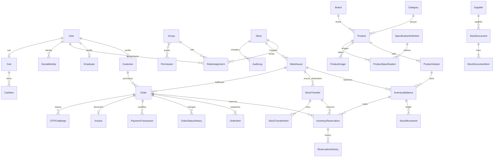

# Thiết kế MySQL

InnoDB, utf8mb4, Django ORM/migrations; mọi PK BigAutoField, FK PROTECT cho lịch sử giao dịch, CASCADE chỉ cho nội dung phụ thuộc chưa giao dịch. Tiền Decimal(18,2), thời gian timezone-aware, JSON cho snapshot gốc. Field dictionary chi tiết được sinh từ model sau migration để luôn khớp code.

Mapping dưới đây mô tả dữ liệu nguồn ban đầu. Sau review được ghi audit, metadata vận hành có thể khác source_snapshot: 13 Mac mini sang Máy tính để bàn, 4 condition sang Đã qua sử dụng và 14 Product lặp is_active=false. Vẫn giữ đủ 278 identities/snapshots và toàn bộ ledger; không có migration gộp/xóa SKU hay sửa số dư trực tiếp. Xem docs/CATALOG_DATA_REVIEW.md và be/data/catalog_corrections.json.

Unique: normalized email; namespace+source_id; SKU; internal slug; warehouse+variant; user+group+store; cart+variant; payment(order,key); invoice(order); idempotency(scope,key). Check: prices>=0, quantities>0, balance>=reserved>=0, transfer source!=destination, reservation đúng một order/transfer. Index: order(store,status,created_at), movement(balance,created_at), reservation(status,expires_at), source identity, SKU. Source condition là chuỗi nghiệp vụ vì năm nhãn thực tế có thể mở rộng mà không mất nguyên văn.

Mapping: id->source_id; category->Category.source_key/name; brand->Brand.name sau whitespace; name/description->Product; price/condition/warranty_months/sku->Variant; image->Image.url; specs->raw_specs và Specification text/numeric/unit có kiểm chứng; inventory->default Warehouse/Balance + INITIAL movement; total_stock->reconciliation; slug->original_slug + unique slug; source_url/url và mọi khóa->source_snapshot. Không dùng URL nguồn cho route nội bộ. Không lưu lịch sử chatbot.

Từ điển mọi field/type/null/PK/FK và constraints/indexes của code thực tế ở [MODEL_DICTIONARY.md](MODEL_DICTIONARY.md), sinh bằng `python scripts/export_model_dictionary.py`. ERD mô tả quan hệ nghiệp vụ; dòng sản phẩm vừa tạo thủ công có thể chưa có variant, public API chỉ hiển thị khi có variant đang bán. Import nguồn luôn tạo một variant mặc định.
