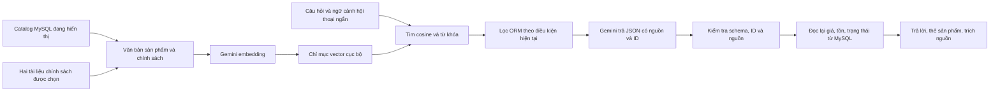

# Chatbot RAG TechRetail — 22/10/2026

## Phạm vi đã triển khai

Trợ lý tư vấn bằng tiếng Việt, tìm sản phẩm theo ý nghĩa kết hợp từ khóa, lọc danh mục/hãng/ngân sách/chi nhánh, giải thích chính sách bảo hành và checkout. Trả lời có thẻ sản phẩm, nguồn tham khảo mở rộng và thời điểm đọc giá/tồn kho. Câu hỏi về đơn hàng riêng tư hoặc bảo mật được hướng dẫn tới trang chức năng; chatbot không đọc đơn hoặc thực hiện giao dịch.

Đây là tích hợp Gemini thật: model generation cấu hình ở backend, mặc định `gemini-3.1-flash-lite`; embedding `gemini-embedding-001`, 768 chiều. Đã xác minh cả embedding và generation bằng key local; model 2.5 Flash Lite trả 404 trong lần kiểm tra nên không dùng làm cấu hình mặc định.

## Kiến trúc



Với catalog hiện tại, dùng **exact cosine** trên vector chuẩn hóa trong file JSON `.runtime/rag/index.json`, kết hợp điểm từ khóa/tên. Chưa dùng Chroma hoặc PostgreSQL/pgvector; không đổi database nghiệp vụ hay thêm dependency. Chỉ mục là cache có thể xây lại, không phải nguồn sự thật của đơn hàng/kho. Quy mô lớn hoặc nhiều worker nên thay lớp index bằng vector service và dùng throttle/cache chung; bản này phục vụ local đồ án.

## Nguồn và đồng bộ

- Chỉ lập chỉ mục sản phẩm, danh mục, thương hiệu và biến thể active; lấy tên, thông số, SKU, tình trạng, thời hạn bảo hành và thuộc tính. Không đưa giá/tồn vào embedding.
- Hai tài liệu trong `be/apps/ai_consultation/knowledge/`: bảo hành mô phỏng TR-BH-2026.01 từ quy tắc hiện có tại `shared/warranty.js`/`docs/WARRANTY_DEMO_IMPLEMENTATION.md`, và hướng dẫn checkout/thanh toán/voucher dựa trên luồng hiện có. Chưa có CMS hoặc chức năng tải PDF bất kỳ lên index.
- Theo yêu cầu giao diện ngày 22/10/2026, nguồn cho khách và lời tư vấn không lặp nhãn “mô phỏng cho đồ án”. Nguồn gốc chính sách đồ án vẫn được ghi trong tài liệu kỹ thuật này; không tự xác nhận quyền lợi bảo hành của hãng. Prompt và bước xử lý lời trả lời bỏ ghi chú trong ngoặc/câu giới thiệu, sau khi đã kiểm tra phản hồi gốc. Thông tin thực chất như VNPay dùng môi trường thử nghiệm, thẻ test và điều kiện bảo hành vẫn giữ nguyên.
- Không lập chỉ mục User, Customer, đơn hàng, thanh toán, ảnh đại diện, feedback, source_snapshot, mật khẩu hoặc cấu hình bí mật.
- Văn bản chia đoạn khoảng 1.800 ký tự, chồng 180 ký tự, metadata gồm ID/ref/title/hash. Mỗi câu hỏi đối chiếu nội dung hiện tại, chỉ embed lại đoạn đổi; loại dữ liệu không còn active. Giá/tồn thay đổi không cần re-embed.
- File có model/version/số chiều; sai định dạng hoặc vector hỏng sẽ được xây lại. Ghi file bằng thay thế atomic, checkpoint từng lô. Khi hết quota có thể chạy lại và tái sử dụng các lô đã hoàn tất.
- Cập nhật nội dung chính sách cần kiểm tra nghiệp vụ trước khi thay Markdown. Hash được tính lại ở lần chat hoặc lệnh đồng bộ kế tiếp.

## API và bảo vệ dữ liệu

`POST /api/v1/ai/chat/` tiếp tục dùng session và CSRF hiện có, public cho tư vấn catalog, throttle 8 yêu cầu/phút theo tài khoản/IP trong cấu hình development. Body: `question` tối đa 2.000 ký tự, `history` tối đa 6 lượt có câu hỏi giới hạn, `product_slug` tùy chọn. Backend chỉ dùng tối đa ba câu hỏi trước cho câu hỏi tiếp nối, bỏ nội dung assistant do client gửi và bỏ lượt chứa thông tin bảo mật/đơn hàng. Không ghi lịch sử chat vào database, log hoặc index.

Quy tắc lọc ngân sách/danh mục/hãng/chi nhánh chạy bằng ORM do backend kiểm soát; model không tạo SQL hoặc gọi tool nghiệp vụ. Khi hỏi một danh mục khác, ngữ cảnh trang sản phẩm hiện tại không ép kết quả về danh mục cũ. Bộ phân tích ngôn ngữ là bộ quy tắc giới hạn, không bảo đảm hiểu mọi cách nói; cần UAT thêm trước mở rộng.

Gemini trả JSON gồm `answer`, `variant_ids`, `source_ids`. Backend giới hạn độ dài/số lượng, chặn ID/nguồn ngoài context, yêu cầu nguồn tương ứng cho sản phẩm, từ chối link/HTML. Sau khi kiểm tra ID và nguồn, các câu chứa số tiền hoặc nhận định tồn kho trong tư vấn sản phẩm được loại; nếu không còn văn bản thì dùng lời dẫn trung tính và giữ thẻ hợp lệ. Nhờ vậy việc AI nhắc lại ngân sách không làm hỏng toàn bộ kết quả; số tiền do AI viết cũng không được hiển thị như giá sản phẩm. Câu trả lời không có thẻ vẫn bị từ chối nếu chứa số tiền. Giá, bảo hành và thông tin tồn trong thẻ do backend tạo; kiểm tra lại visibility và điều kiện lọc sau generation. Không có giữ hàng hay bảo đảm giá tới lúc checkout.

API key chỉ ở header gọi Google, URL cố định, không theo redirect, có timeout và giới hạn phản hồi. Log lỗi chỉ ghi phương thức/trạng thái HTTP, không key, câu hỏi hay body provider. Có che email/điện thoại/key thường gặp trong câu hỏi; đây không phải hệ thống DLP hoàn chỉnh, người dùng vẫn được nhắc không gửi dữ liệu nhạy cảm. Câu hỏi công khai và các đoạn kiến thức liên quan được gửi tới Gemini để xử lý.

Google lỗi kết nối/503/hết quota: chat chuyển sang `mode=catalog`, HTTP 200/no-store, ghi rõ AI tạm ngừng và chỉ trả kết quả lọc cơ bản từ database. Giá/tồn, active, hãng, ngân sách, chi nhánh vẫn được kiểm tra bằng ORM; tối đa ba sản phẩm khác nhau theo giá tăng dần. Từ “gaming” yêu cầu có trong tên; không tự suy luận sản phẩm phù hợp học tập/ngành nghề. Thiếu loại thiết bị thì hỏi thêm; câu hỏi chính sách báo chưa thể trả lời, không tự tạo chính sách hoặc nguồn RAG giả. Không nới kiểm tra đầu ra không hợp lệ, ID/nguồn hay quyền/CSRF. Khi provider lỗi availability/quota, cache ghi mã lỗi và tạm ngưng gọi provider trong 30 giây; sau đó câu hỏi tiếp theo thử RAG lại. Cache local theo tiến trình, cần cache chung khi nhiều worker. Không lưu câu hỏi hoặc câu trả lời trong cache này.

Web không tự lặp request. Transport backend chỉ thử lại một lần sau 1 giây cho HTTP 500/502/503/504; không tự lặp lỗi quyền, key, redirect hoặc quota. Timeout mỗi lần là kết nối 5 giây/đọc 25 giây, nên lần đầu phát hiện sự cố vẫn có thể chờ. CLI đồng bộ được chờ tối đa hai lần 40 giây mỗi lô khi quota tạm thời. Trong chế độ danh mục, câu hỏi trước vẫn được giữ cho lượt tiếp như “Từ 10 đến 15 triệu”; giá/tồn được đọc lại mỗi lượt. Mọi thông tin diễn giải RAG còn phụ thuộc mô hình, nên trích nguồn không có nghĩa đã tự động chứng minh mọi phát biểu đúng.

## Cấu hình và chạy

File riêng `be/.env` (không commit):

```dotenv
GEMINI_ENABLED=true
GEMINI_API_KEY=your_private_key
GEMINI_MODEL=gemini-3.1-flash-lite
```

Sau đổi `.env`, khởi động lại Django. Từ thư mục ứng dụng:

```powershell
cd be
..\.venv\Scripts\python.exe manage.py rebuild_rag_index
```

Lệnh mặc định đồng bộ tăng dần. Chỉ dùng `--rebuild` khi muốn embed lại toàn bộ; tốn thêm quota. Không cần migration mới. Với một key/model khác, kiểm tra model được cấp quyền và hạn mức trong AI Studio trước khi bật. `.runtime` và `.env` bị Git bỏ qua; Vite không phục vụ thư mục chỉ mục.

## Kiểm chứng và giới hạn

- Toàn bộ backend: **255 tests PASS** trên database MySQL riêng `test_tech_retail`, không phải database ứng dụng. Nhóm RAG **18 tests PASS**, cùng hai hợp đồng retrieval/flag tắt tạo thành nhóm 20 ca chạy lại sau chỉnh sửa. Gồm HTTP transport/che lỗi, vector lỗi, index tăng dần/prune/corrupt/checkpoint, nguồn công khai, bộ lọc, giá/tồn thay đổi trong lúc generation, sản phẩm vừa ẩn, không nhận ID/link giả, không dùng assistant history, giới hạn input/CSRF/throttle, thử lại có giới hạn khi provider 503 và luồng tắt.
- **132 Vitest tests PASS**, **4 Node tests PASS**, build fe/admin PASS. Sáu ca UI mới kiểm tra thẻ/nguồn/context, xóa khi request còn chờ, đổi tài khoản, lỗi/thử lại, flag tắt và chỉ link tới route được phép.
- Đã lập **270 đoạn** từ catalog hiện tại và hai tài liệu, gọi Gemini thật để tư vấn laptop theo ngân sách và trả lời chính sách đổi lỗi. Từng gặp quota khi lập chỉ mục và lỗi provider 503 tạm thời lúc chat; cơ chế checkpoint và nút thử lại đã được dùng, không đổi sang câu trả lời giả.
- Browser local đã kiểm tra trả thẻ laptop ASUS dưới 20 triệu tại Cầu Giấy và nguồn đi kèm. Ảnh trong `screenshots/rag-chat-products.png` và `screenshots/rag-chat-policy.png` cho kết quả nghiệm thu trình duyệt.
- Chưa đo chất lượng trên tập câu hỏi lớn, tải nhiều người, thiết bị di động thực hoặc triển khai nhiều worker; chưa bảo đảm các thông số phần cứng được tư vấn đúng cho mọi nhu cầu. Không có thanh toán thật hoặc thay đổi dữ liệu đơn/kho/hồ sơ trong nghiệm thu chat.

Tham khảo API chính thức: [Gemini embeddings](https://ai.google.dev/gemini-api/docs/embeddings), [structured output](https://ai.google.dev/gemini-api/docs/structured-output).
